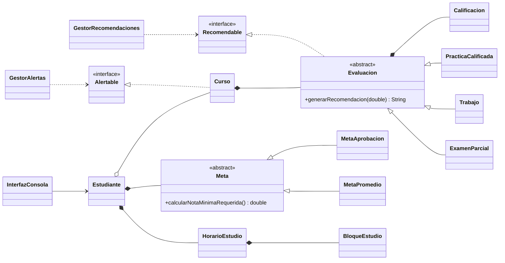

<div align="center">

# 🎓 Plataforma de Gestión y Predicción Académica

**Sistema en Java que ayuda al estudiante a saber cuánto necesita para aprobar, si sus metas son posibles y cómo organizar su estudio.**


[Presentación](#-presentación) •
[Equipo](#-equipo-de-desarrollo) •
[Funcionalidades](#-funcionalidades) •
[Arquitectura](#-arquitectura) •
[Ejecución](#-cómo-ejecutar) •
[POO aplicada](#-conceptos-de-poo-aplicados)

</div>

---

## 🏛️ Datos académicos

| | |
|---|---|
| **Universidad** | `[Nombre de la universidad]` |
| **Facultad / Escuela** | `[Facultad] – [Escuela profesional]` |
| **Curso** | Desarrollo de Software Orientado a Objetos |
| **Docente** | `[Nombre del docente]` |
| **Ciclo / Sección** | `[Ciclo]` – `[Sección]` |
| **Semestre** | `[2026-II]` |
| **Entrega** | Segundo avance: código fuente ejecutable en consola |

---

## 📌 Presentación

Muchos estudiantes llegan al examen final sin saber **qué nota necesitan** para aprobar un curso, o descubren
demasiado tarde que una meta (tercio superior, quinto superior, beca) ya no era posible.

La **Plataforma de Gestión y Predicción Académica** resuelve ese problema: el estudiante registra sus cursos,
evaluaciones y notas, y el sistema **calcula, predice y recomienda** en tiempo real.

> 💡 **Ejemplo:** con PC1 = 12 (20%) y PC2 = 10 (20%), el sistema indica que necesitas **10.17** en el parcial
> (60%) para aprobar, y que llegar a 17 **ya no es posible**, porque requeriría un 21.

### 🎯 Objetivos

- **General:** desarrollar un sistema orientado a objetos que apoye al estudiante en el seguimiento y la predicción de su rendimiento académico.
- **Específicos:**
  - Calcular la nota mínima necesaria en las evaluaciones pendientes de cada curso.
  - Determinar si las metas académicas son alcanzables o imposibles.
  - Identificar los cursos en riesgo y emitir alertas por nivel.
  - Generar recomendaciones y un horario de estudio según el riesgo de cada curso.

---

## 👥 Equipo de desarrollo

<table>
  <tr>
    <td align="center" width="33%">
      <br/><br/>
      <b>[Nombres y Apellidos]</b><br/>
      Código: <code>[U00000000]</code><br/>
      <a href="https://github.com/USUARIO1">@USUARIO1</a><br/>
      <sub>[correo@ejemplo.com]</sub>
    </td>
    <td align="center" width="33%">
      <br/><br/>
      <b>[Nombres y Apellidos]</b><br/>
      Código: <code>[U00000000]</code><br/>
      <a href="https://github.com/USUARIO2">@USUARIO2</a><br/>
      <sub>[correo@ejemplo.com]</sub>
    </td>
    <td align="center" width="33%">
      <br/><br/>
      <b>[Nombres y Apellidos]</b><br/>
      Código: <code>[U00000000]</code><br/>
      <a href="https://github.com/USUARIO3">@USUARIO3</a><br/>
      <sub>[correo@ejemplo.com]</sub>
    </td>
  </tr>
  <tr>
    <td valign="top"><sub><code>Curso</code>, <code>Evaluacion</code>, <code>PracticaCalificada</code>, <code>Trabajo</code>, <code>ExamenParcial</code>, <code>Calificacion</code></sub></td>
    <td valign="top"><sub><code>Estudiante</code>, <code>Meta</code>, <code>MetaAprobacion</code>, <code>MetaPromedio</code>, <code>HorarioEstudio</code>, <code>BloqueEstudio</code></sub></td>
    <td valign="top"><sub><code>Alertable</code>, <code>Recomendable</code>, <code>Alerta</code>, <code>GestorAlertas</code>, <code>GestorRecomendaciones</code>, <code>InterfazConsola</code>, <code>Main</code></sub></td>
  </tr>
</table>

---

## ✨ Funcionalidades

| | Funcionalidad | Descripción |
|:-:|---|---|
| 📚 | **Gestión de cursos** | Registro de cursos, créditos y evaluaciones (prácticas, trabajos y exámenes) con su peso. |
| 📝 | **Registro de notas** | Validación de la escala 0–20 y control de que los pesos sumen 100%. |
| 🧮 | **Nota necesaria** | Calcula cuánto necesitas en lo que falta rendir para aprobar o para llegar a una nota objetivo. |
| 🎯 | **Metas académicas** | Metas por curso o por promedio general ponderado (tercio, quinto superior, beca). Indica si son alcanzables o imposibles. |
| 🚨 | **Alertas de riesgo** | Clasifica cada curso en riesgo **ALTO**, **MEDIO** o **BAJO**. |
| 💬 | **Recomendaciones** | Consejos distintos según el tipo de evaluación pendiente. |
| 🗓️ | **Horario de estudio** | Reparte las horas de la semana según créditos, riesgo y disponibilidad diaria. |

---

## 🏗️ Arquitectura

El diagrama de clases UML completo está en [`docs/diagrama_clases_uml.pdf`](docs/diagrama_clases_uml.pdf).



### 📁 Estructura del repositorio

```
plataforma-academica/
├── 📄 README.md
├── 📄 GUIA_GITHUB.md          Guía de trabajo en equipo con Git
├── ▶️ ejecutar.bat / ejecutar.sh
├── 📂 docs/
│   └── diagrama_clases_uml.pdf
└── 📂 src/
    ├── 📂 nucleo/             Módulo 1 · Núcleo académico
    ├── 📂 planificacion/      Módulo 2 · Estudiante, metas y horario
    ├── 📂 analisis/           Módulo 3 · Alertas y recomendaciones
    └── 📂 consola/            Módulo 3 · Interfaz de consola y Main
```

---

## 🚀 Cómo ejecutar

**Requisito:** JDK 8 o superior (`java -version`).

<details open>
<summary><b>🪟 Windows</b></summary>

```bat
ejecutar.bat
```
</details>

<details>
<summary><b>🐧 Linux / 🍎 macOS</b></summary>

```bash
chmod +x ejecutar.sh
./ejecutar.sh
```
</details>

<details>
<summary><b>⌨️ Manual (cualquier sistema)</b></summary>

```bash
javac -encoding UTF-8 -d bin src/nucleo/*.java src/planificacion/*.java src/analisis/*.java src/consola/*.java
java -cp bin consola.Main
```
</details>

<details>
<summary><b>🧩 Desde un IDE (NetBeans / IntelliJ)</b></summary>

Abre la carpeta como proyecto Java, marca `src` como carpeta de fuentes y ejecuta `consola.Main`.
</details>

> 🧪 El sistema inicia con **datos de prueba ficticios** que muestran todos los casos (riesgo ALTO, MEDIO y BAJO,
> y metas alcanzables e imposibles). Para iniciar sin datos: `java -cp bin consola.Main --vacio`

### 🖥️ Vista previa

```
==============================================
 PLATAFORMA DE GESTION Y PREDICCION ACADEMICA
==============================================
Estudiante: Ana Torres Quispe (U2024-0001)

=== ALERTAS DE RIESGO ===
- [MEDIO] MAT1 - Calculo I: necesitas 13.87 en lo que falta rendir para aprobar (promedio actual 8.25).
- [ALTO] FIS1 - Fisica I: necesitas 16.50 en lo que falta rendir para aprobar.
Resumen: 1 ALTO, 1 MEDIO

=== METAS ===
- [Aprobacion de curso] Llegar a 17.0 en Programacion Orientada a Objetos
    META NO POSIBLE: se necesitaria mas de 20 en lo que falta rendir.
- [Promedio general] Tercio superior (promedio 13.0)
    ALCANZABLE: necesitas 18.06 en lo que falta rendir.
```

---

## 🧮 Reglas de cálculo

**Nota necesaria en un curso**

$$\text{notaNecesaria} = \frac{\text{notaObjetivo} - \text{puntajeAcumulado}}{\text{pesoPendiente} / 100}$$

**Meta de promedio general:** la misma idea, aplicada a todos los cursos y ponderada por créditos.

| Regla | Valor actual | Configurable en |
|---|---|---|
| Escala de notas | 0 – 20 | `Calificacion.NOTA_MINIMA` / `NOTA_MAXIMA` |
| Nota aprobatoria | 10.5 | `Calificacion.NOTA_APROBATORIA` |
| 🔴 Riesgo ALTO | Necesita más de 16, o ya no puede aprobar | `Curso.UMBRAL_RIESGO_ALTO` |
| 🟡 Riesgo MEDIO | Promedio actual menor que 10.5 | `Curso.obtenerNivelRiesgo()` |
| 🟢 Riesgo BAJO | Demás casos | — |
| Horas de estudio | 1 por crédito, +3 si ALTO, +1 si MEDIO | `HorarioEstudio` |

---

## 🧠 Conceptos de POO aplicados

| Concepto | Aplicación en el sistema |
|---|---|
| **Encapsulamiento** | Atributos `private` con getters; `protected` solo en clases abstractas. |
| **Abstracción y herencia** | `Evaluacion` → `PracticaCalificada`, `Trabajo`, `ExamenParcial` · `Meta` → `MetaAprobacion`, `MetaPromedio` |
| **Polimorfismo** | `generarRecomendacion()`, `getTipo()` y `calcularNotaMinimaRequerida()` se comportan distinto en cada subclase. |
| **Sobrecarga** | Constructores sobrecargados; `registrarNota(nota)` y `registrarNota(nota, observacion)`. |
| **Interfaces** | `Alertable` (la implementa `Curso`) y `Recomendable` (la implementa `Evaluacion`). |
| **Composición** | `Curso` ◆ `Evaluacion` ◆ `Calificacion` · `Estudiante` ◆ `HorarioEstudio`, `Meta` |
| **Agregación** | `Estudiante` ◇ `Curso` · `MetaPromedio` ◇ `Curso` |
| **Asociación** | `MetaAprobacion`, `BloqueEstudio` y `Alerta` → `Curso` |
| **Miembros `static`** | Constantes de escala, `esNotaValida()`, `DIAS[]`, `main` |
| **Estructuras de datos** | `ArrayList`, `HashMap<String, Integer>`, arreglos `String[]` e `int[][]` |
| **Separación de responsabilidades** | Solo `InterfazConsola` lee e imprime; las clases de cálculo no usan `Scanner` ni `System.out`. |

---

## 🗺️ Avances del proyecto

- [x] **Avance 1:** diagrama de clases UML
- [x] **Avance 2:** código fuente ejecutable en consola, organizado en GitHub
- [ ] **Avance 3:** `[por definir]`
- [ ] **Entrega final:** `[por definir]`

---

<div align="center">

**`[Nombre de la universidad]`** · Desarrollo de Software Orientado a Objetos · `[2026-II]`

<sub>Proyecto académico desarrollado con fines educativos. Los datos de prueba son ficticios.</sub>

</div>
